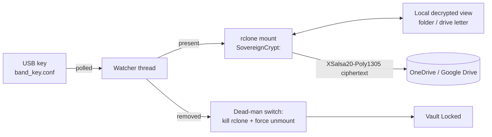

# Sovereign Mesh — OCAP-Oriented Cloud Encryption Wrapper (Proof of Concept)

> **Proof of concept only.** Not security-audited, not certified, and not a statement of OCAP® compliance. See [Limitations & Security Notes](#limitations--security-notes).

Sovereign Mesh is a small desktop wrapper for First Nations IT Managed Service Providers (MSPs) and Band Managers. It encrypts files **on the Band's own computer before they reach a public cloud** (Microsoft OneDrive / SharePoint, Google Drive). The cloud provider only stores ciphertext. The vault can only be opened while a physical USB "hardware key" is plugged in.

## The Sovereignty Challenge

The First Nations principles of **OCAP®** — **Ownership, Control, Access and Possession** — describe how First Nations data should be collected, protected, used and shared. OCAP® is a registered trademark of the [First Nations Information Governance Centre (FNIGC)](https://fnigc.ca/ocap-training/).

Many Nations are moving records (lands and treaty maps, financial audits, social and family-services files) into Microsoft 365 or Google Workspace. With standard configurations:

- **The provider holds the encryption keys.** Data is encrypted at rest, but the provider can decrypt it, which complicates the *Possession* and *Control* principles.
- **Foreign legal exposure.** US-headquartered providers can be compelled under the US **CLOUD Act** (2018) to produce data in their "possession, custody, or control", even when it is stored in Canadian data centres. Canadian legal processes can also apply. In many cases the Nation may not be notified before disclosure.

Customer-managed-key and "sovereign cloud" offerings reduce some of this risk, but generally still rely on the provider's infrastructure for key use.

## The Sovereign Mesh Approach

Client-side, **zero-knowledge** encryption: data is encrypted before upload, and keys never leave the Nation's control.

- Uses **[rclone crypt](https://rclone.org/crypt/)**, a widely used open-source tool.
- File contents are encrypted with **NaCl secretbox (XSalsa20-Poly1305)**, giving confidentiality plus tamper detection. File names can also be encrypted.
- Keys are derived from your password and salt using **scrypt**.
- The cloud provider sees only encrypted blobs.

Being open source means the code and cryptography **can be publicly reviewed**. It does not by itself *guarantee* the absence of flaws or backdoors; it makes independent verification possible.

## How It Works

1. An IT provider configures an rclone cloud remote and a crypt remote named `SovereignCrypt:` layered on top of it.
2. A USB drive holds `band_key.conf`. Optionally, its first line is the password that unlocks an encrypted `rclone.conf` (passed to rclone as `RCLONE_CONFIG_PASS`, never logged), so the vault **cannot be opened without the USB key**.
3. The Band Manager clicks **Arm Hardware Key Watcher**. A background thread polls for the key file.
4. **Key detected →** `rclone mount SovereignCrypt: <mount> --vfs-cache-mode writes` starts, and the decrypted vault appears as a folder (Linux) or drive letter (Windows). Status turns **green**.
5. **Key removed (or path unreadable) → dead-man switch:** the rclone process is killed immediately and the mount is force-unmounted (`fusermount3 -uz` / `fusermount -uz` / `umount -l` on Linux, `taskkill /F /IM rclone.exe` on Windows). Status turns **red**. The same lock runs on disarm, window close and app exit.



## Installation

### 1. rclone
```bash
# Linux
curl https://rclone.org/install.sh | sudo bash
# Windows (PowerShell)
winget install Rclone.Rclone
```

### 2. FUSE layer
```bash
# Debian/Ubuntu
sudo apt install fuse3
# Fedora/RHEL
sudo dnf install fuse3
# Windows (PowerShell)
winget install WinFsp.WinFsp
```
macOS (macFUSE) is **unsupported/untested** in this PoC.

### 3. Python dependencies (Python 3.8+)
```bash
pip install customtkinter
```
On Linux you may also need Tk: `sudo apt install python3-tk`.

### 4. Configure rclone remotes
```bash
rclone config
```
1. `n` (new remote) → name `cloud` → storage `onedrive` (or `drive` for Google Drive) → follow the browser sign-in.
2. `n` → name `SovereignCrypt` → storage `crypt` → remote `cloud:sovereign-vault` → filename encryption `standard` → set a **strong password and salt** (store these offline; they are the real keys).
3. Recommended: `s` (set configuration password) to encrypt `rclone.conf`. Put that config password on the first line of `band_key.conf` on the USB drive.

Check where your config lives with `rclone config file`. Keep it off shared or synced folders.

### 5. Run
```bash
python sovereign_wrapper.py --usb-path /media/$USER/BANDKEY --mount ~/SovereignVault
# Windows
python sovereign_wrapper.py --usb-path E:\ --mount S:
# Or with a JSON config / headless mode
python sovereign_wrapper.py --config config.json --headless
```
Example `config.json`:
```json
{"usb_key_path": "/media/band/BANDKEY", "key_filename": "band_key.conf",
 "rclone_remote": "SovereignCrypt:", "mount_point": "/home/band/SovereignVault",
 "poll_interval": 0.5}
```

## Limitations & Security Notes

- **Proof of concept.** Not independently audited or penetration-tested. Do not use for production sensitive data without review.
- **Not certified OCAP® compliance.** Technical controls support, but do not replace, governance. Any use needs approval under the Nation's own data governance processes.
- **Metadata is still visible** to the cloud provider: file sizes (approximate), number of files, folder structure size, timestamps and access patterns.
- **Data is exposed while unlocked.** Anyone or anything with access to the computer while the key is inserted can read the files.
- **The VFS cache may hold plaintext on local disk** (`--vfs-cache-mode writes`). Put the rclone cache (`--cache-dir`) on encrypted local storage (BitLocker, LUKS) and use full-disk encryption.
- **The dead-man switch kills rclone immediately.** Writes still in progress or not yet uploaded may be lost or incomplete.
- **No protection against a compromised endpoint** (malware, keyloggers, remote-access tools).
- **Lose the key, lose the data.** There is no recovery by the provider or by us. Keep secure offline backups of the crypt password/salt and the USB key.
- **`rclone.conf` matters.** It contains cloud tokens and (obscured, not strongly encrypted) crypt passwords unless you set a config password. Protect its location and encrypt it.
- Polling (default 0.5 s) means a short window between key removal and lock.

## Disclaimer

This software is provided "as is", without warranty of any kind. It is not legal advice and makes no claim of compliance with OCAP®, privacy law, or any certification standard. OCAP® is a registered trademark of the First Nations Information Governance Centre; this project is not affiliated with or endorsed by FNIGC.

## License

[MIT](LICENSE)
